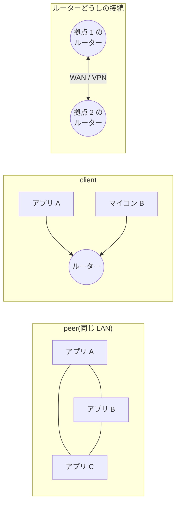

# Zenoh 入門:zenoh-pico でマイコンをつなぎ、ROS 2 と接続するまで

2026 年 11 月時点の Zenoh 1.10.2 で確認した内容です。サンプルは、Python・Rust・zenoh-pico(Linux)のあいだの通信と、ROS 2 Jazzy のブリッジ構成・rmw_zenoh 構成で動作を確かめています。ESP32 のサンプルはビルドまで確認し、実機では動かしていません。

Zenoh は、pub/sub と問い合わせ(query)を同じキーの体系で扱える通信ミドルウェアです。端末どうしがルーターなしで直接つながる構成から、ルーターを経由して拠点やクラウドをまたぐ構成まで、アプリのコードを変えずに組めます。マイコン向けの C 実装である zenoh-pico を使えば ESP32 のような小さな機器も同じネットワークに参加でき、ROS 2 とは DDS ブリッジ(zenoh-bridge-ros2dds)と RMW 実装(rmw_zenoh)の 2 通りの方法でつながります。

この記事は次の順に進みます。1〜3 章で Zenoh の考え方(キー式と 3 つのモード)を説明し、4 章で Python のサンプルを動かします。5 章で zenoh-pico を PC と ESP32 で動かし、6 章で ROS 2 とつなぎます。7 章はつまずきやすい点の一覧、8 章はテンプレートとして使うときの手順です。

サンプルコードはすべて、この記事と同じリポジトリ(zenoh-template)に入っています。文中のパスはこのリポジトリの中のものです。

想定する読者は、MQTT や ROS 2 のトピックで pub/sub を使ったことがあり、Zenoh は初めての人です。

## 1. Zenoh の概要

### ひとつのキー空間で pub/sub・保存・問い合わせを扱う

Zenoh の名前は「Zero Overhead Pub/sub, Store/Query and Compute」に由来します。流れているデータ(pub/sub)、保存されたデータ(ストレージ)、問い合わせのたびに計算して返すデータ(Queryable)を、どれも同じ形式のキーで指定します。たとえば `robot/arm/joint_states` に publish された値は、購読すれば流れてくるデータとして受け取れますし、ストレージに保存しておけば `get` で最新値を問い合わせられます。

MQTT と比べると、ブローカー(Zenoh ではルーター)を必ずしも置かなくてよい点と、問い合わせが通信の操作として組み込まれている点が違います。DDS と比べると、ルーターを介して拠点やクラウドをまたぐ構成を前提に設計されている点が違います。

### 1.x 系が続き、ROS 2 では Tier 1 の RMW になった

Zenoh は Eclipse Foundation のプロジェクトで、ZettaScale Technology が中心になって開発しています。2024 年 10 月 21 日に 1.0.0 が公開され、その後も 1.x 系のマイナーリリースが続いています。2026 年 8 月に 1.10(コードネーム Mucalinda)が出て、この記事を書いた時点の最新は 10 月 28 日公開の 1.10.2 です。2026 年 1 月の Zenoh のニュースレターでは、2.0 を 2026 年後半に公開する計画が示されていました。

ROS 2 では、Kilted Kaiju(2025 年 5 月)で rmw_zenoh_cpp が Tier 1 の RMW 実装になりました(REP 2000)。ただし、既定の RMW は Kilted でも、2026 年 5 月の Lyrical Luth でも Fast DDS のままです。

本体は Rust で書かれていて、C(zenoh-c と zenoh-pico)、C++、Python、Kotlin、Java、TypeScript、Go からも使えます。

注意したいのは、0.x 系と 1.x 系で API が大きく変わったことです。ネット上の記事やサンプルには 0.x 系のものが多く残っているので、関数名や引数が合わないときはバージョンを確かめてください。0.x 系と 1.x 系は通信もできないので、ルーターとアプリはなるべく同じバージョンにそろえます。

## 2. データの宛先は `/` 区切りのキー式で決める

Zenoh のデータには必ずキーが付きます。キーは `robot/arm/joint_states` のように `/` で区切った文字列で、区切られた各部分をチャンクと呼びます。先頭と末尾には `/` を付けません。

購読や問い合わせでは、ワイルドカードを含むキー式を使えます。

| 書き方 | 一致するもの | 例 | 一致するキーの例 |
|---|---|---|---|
| `*` | チャンク 1 つ | `robot/*/battery` | `robot/a/battery` |
| `**` | 0 個以上のチャンク | `robot/**` | `robot`、`robot/a/battery` |
| `$*` | チャンクの一部 | `sensor/temp$*` | `sensor/temp1`、`sensor/temp_out` |

問い合わせでは、キー式のあとに `?` でパラメーターを付けた「セレクター」を渡せます(`demo/info/**?verbose=true`)。パラメーターをどう解釈するかは、応答する側のアプリが決めます。

ペイロードはただのバイト列です。文字列、JSON、Protocol Buffers、ROS 2 の CDR など、何を入れるかはアプリどうしの取り決めで決めます。`text/plain` のようなエンコーディングをメタデータとして添えることもできますが、Zenoh が中身を変換することはありません。

通信の操作は主に次の 3 種類です。

| 操作 | 送る側 | 受ける側 | 向いている用途 |
|---|---|---|---|
| put / subscribe | Publisher | Subscriber | センサー値や制御指令のように流れ続けるデータ |
| get / queryable | `get` を呼ぶ側 | Queryable、ストレージ | 設定の読み出し、RPC、最新値の取得 |
| liveliness | トークンを宣言する側 | 購読・問い合わせする側 | 生存確認、参加しているノードの一覧 |

`get` には応答が複数返ることがあります。キー式に一致する Queryable が 3 つあれば、応答も 3 つ返ります。

## 3. ピア・クライアント・ルーターの使い分け

Zenoh のセッションには peer、client、router の 3 つのモードがあり、どのモードでもアプリのコードは同じです。違うのは、誰とつながり、データをどこ経由で送るかです。



| モード | つながる相手 | データの経路 | 主な用途 |
|---|---|---|---|
| peer | UDP マルチキャスト(既定は 224.0.0.224:7446)で見つけた同じ LAN の相手 | 相手と直接 | LAN の中の PC やロボットどうし |
| client | 指定した(または見つけた)ルーター 1 台 | すべてルーター経由 | マイコン、遠隔地の端末 |
| router | client、ほかのルーター | client どうしやルーター間を中継 | 拠点の中継点、ストレージ、REST |

Python や Rust のセッションは、何も設定しなければ peer で始まります。zenoh-pico の既定は client です。client は接続先のルーターが見つからないとセッションを開けない(既定の設定では失敗して終わる)ので、ルーターを先に起動しておきます。ルーターは単体の実行ファイル `zenohd` として配布されていて、REST API やストレージをプラグインとして持てます。標準のポートは 7447/tcp です。

開発中は、ルーターを 1 台立てて全員をそこにつなぐ構成にすると、マルチキャストが届くかどうかに左右されずに済みます。マルチキャストは、Wi-Fi のアクセスポイントがクライアント間の通信を遮断している場合や、Docker Desktop のコンテナとホストの間では届きません。そのときは接続先(`connect`)を明示します。

テンプレートの `config/` に 3 つのモードの設定ファイルがあります。client の設定は次のとおりです。

```json5
{
  mode: "client",
  connect: {
    endpoints: ["tcp/127.0.0.1:7447"],
  },
}
```

## 4. Python で pub/sub と問い合わせを動かす

### インストールとルーターの起動

Python 版は PyPI の `eclipse-zenoh` です。1.10 からは Debian パッケージ(`python3-eclipse-zenoh`)も提供されています。テンプレートでは uv で依存を入れます。

```powershell
cd python
uv sync
```

ルーターは Docker で起動するのが手軽です。リポジトリ直下の `docker-compose.yml` は、`eclipse/zenoh:1.10.2` のイメージに `config/router.json5` を読ませて起動します。

```powershell
docker compose up -d
```

Docker を使わない場合は、GitHub のリリースページから OS に合ったスタンドアロン版を取得し、`zenohd -c config/router.json5` で起動します。Windows 用は `zenoh-1.10.2-x86_64-pc-windows-msvc-standalone.zip` です。

### publish と subscribe

送信側の中心部分は次の数行です([python/pub.py](../python/pub.py) を短くしたもの)。

```python
import zenoh

conf = zenoh.Config.from_file("../config/client.json5")
with zenoh.open(conf) as session:
    pub = session.declare_publisher("demo/hello/python")
    pub.put("Hello from Python")
```

受信側は、サンプルが届くたびに呼ばれる関数を登録します([python/sub.py](../python/sub.py))。

```python
def on_sample(sample: zenoh.Sample) -> None:
    print(sample.key_expr, sample.payload.to_string())

with zenoh.open(conf) as session:
    session.declare_subscriber("demo/hello/**", on_sample)
    ...  # プログラムが終わらないように待つ
```

テンプレートのサンプルは、`-m` でモードを、`-e` で接続先を指定できます。別々のターミナルで次の 2 つを実行すると、`sub.py` 側に受信したデータが表示されます。

```powershell
uv run sub.py -m client -e tcp/127.0.0.1:7447
```

```powershell
uv run pub.py -m client -e tcp/127.0.0.1:7447
```

Rust でも構造は同じです。`zenoh::open(config).await?` でセッションを開き、`declare_publisher` と `put` で送ります([rust/src/bin/pub.rs](../rust/src/bin/pub.rs))。

### get と queryable

問い合わせに答える側は `declare_queryable` で待ち受け、届いた問い合わせに `reply` で答えます([python/queryable.py](../python/queryable.py))。

```python
queryable = session.declare_queryable("demo/info/python")
while True:
    with queryable.recv() as query:
        query.reply("demo/info/python", "python queryable")
```

問い合わせる側は、`get` の戻り値をループで回して応答を順に受け取ります([python/get.py](../python/get.py))。全員が応答し終えるか、タイムアウトになるとループが終わります。

```python
for reply in session.get("demo/info/**", timeout=5.0):
    if reply.ok is not None:
        print(reply.ok.key_expr, reply.ok.payload.to_string())
```

### ストレージと REST API で最新値を取る

ルーターの設定(`config/router.json5`)では、REST プラグイン(8000 番ポート)と、`demo/hello/**` の最新値をメモリに保持するストレージを有効にしています。`pub.py` を動かしたあとで HTTP の GET を送ると、ストレージが保持している最新値が返ります。

```powershell
curl.exe http://localhost:8000/demo/hello/**
```

PowerShell 5.1 では `curl` が Invoke-WebRequest の別名になっているので、`curl.exe` と書いています。

結果はキー・値・エンコーディング・タイムスタンプを並べた JSON の配列です。値が文字列のまま入るのは、エンコーディングが `text/plain` のようなテキストのときだけで、それ以外は base64 にした文字列が入ります。テンプレートの `pub.py` は `pub.put(msg, encoding=zenoh.Encoding.TEXT_PLAIN)` と明示しているので、文字列のまま返ります。

## 5. zenoh-pico でマイコンをつなぐ

### zenoh-pico は C で書かれた Zenoh の実装

zenoh-pico は、メモリの小さな機器向けに C で書かれた Zenoh の実装です。API は Rust 本体の C バインディングである zenoh-c と共通なので、同じ書き方で PC とマイコンのコードを書けます。README の対応表には、Unix、Windows、Zephyr、Arduino、ESP-IDF、Mbed OS、OpenCR、Emscripten、FreeRTOS-Plus-TCP、Raspberry Pi Pico が載っています。通信路は TCP と UDP(ユニキャストとマルチキャスト)が基本で、環境によってはシリアルや Bluetooth(Arduino)も使えます。

既定のモードは client で、ルーターに接続します。zenoh-pico どうしなら、UDP マルチキャストを使った peer モードで、ルーターなしにやり取りすることもできます。マルチキャストの peer と TCP の client を混ぜたいときは、マルチキャストとユニキャストの両方で待ち受けるルーターを間に置きます。

### owned・loaned・moved の 3 種類の型を区別する

zenoh-pico の API を読むときに押さえておきたいのは、値の持ち方を表す 3 種類の型です。

| 型 | 意味 | 作り方と使い方 |
|---|---|---|
| `z_owned_xxx_t` | 資源を所有している値 | 使い終わったら `z_drop(z_move(x))` で解放する |
| `z_loaned_xxx_t` | 借りている参照 | `z_loan(x)` で作って関数に渡す。所有権は移らない |
| `z_moved_xxx_t` | 所有権を渡す途中の値 | `z_move(x)` で作る。渡したあとの `x` は使わない |

このほかに、文字列などをコピーせずに参照する `z_view_xxx_t`(例:`z_view_keyexpr_t`)があります。`z_loan` や `z_move` は、C11 の `_Generic` で型ごとの関数に振り分けるマクロです。C++ 向けには同じ名前のオーバーロード関数が用意されています。ただし、これらは C99 でビルドする環境では定義されません。PlatformIO の Arduino ESP32 ビルドがこれに当たるので、その場合は `z_session_loan(&s)` や `z_bytes_move(&payload)` のように、型ごとの関数を直接呼びます。

publish の流れは次のとおりです([pico/desktop/src/pico_pub.c](../pico/desktop/src/pico_pub.c) を短くしたもの)。

```c
z_owned_config_t config;
z_config_default(&config);
zp_config_insert(z_loan_mut(config), Z_CONFIG_CONNECT_KEY, "tcp/127.0.0.1:7447");

z_owned_session_t s;
if (z_open(&s, z_move(config), NULL) < 0) {
    /* ルーターに接続できなかった */
}

z_view_keyexpr_t ke;
z_view_keyexpr_from_str(&ke, "demo/hello/pico");
z_owned_publisher_t pub;
z_declare_publisher(z_loan(s), &pub, z_loan(ke), NULL);

z_owned_bytes_t payload;
z_bytes_copy_from_str(&payload, "Hello from zenoh-pico");
z_publisher_put(z_loan(pub), z_move(payload), NULL);  // payload の所有権は put に移る

z_drop(z_move(pub));
z_drop(z_move(s));
```

`config` は `z_open` に、`payload` は `z_publisher_put` に、それぞれ `z_move` で渡しています。受け取った関数が解放するので、呼び出し側で `z_drop` する必要はありません。

### 古い記事との違い:受信タスクは z_open が始める

0.x 系の記事やサンプルでは、セッションを開いたあとに `zp_start_read_task` と `zp_start_lease_task` を呼び、受信とキープアライブのタスクを自分で起動していました。1.10.2 では、マルチスレッド対応でビルドしていれば(`Z_FEATURE_MULTI_THREAD=1`、既定値)、これらのタスクは `z_open` の中で自動的に始まります。`z_open` のオプションにある `auto_start_read_task` などの項目も非推奨になりました。シングルスレッドでビルドした場合の書き方は、zenoh-pico のサンプルの `z_pub_st.c` と `z_sub_st.c` にあります。

ペイロードの渡し方も変わりました。0.x 系ではポインターと長さを渡していましたが、1.x 系では `z_owned_bytes_t` に入れて渡します。

### PC でビルドする

[pico/desktop](../pico/desktop/CMakeLists.txt) は、CMake の FetchContent で zenoh-pico 1.10.2 を取得し、静的ライブラリとして組み込みます。zenoh-pico をサブプロジェクトとして取り込むと、zenoh-pico 本体のサンプルやテストはビルドされません。

```cmake
FetchContent_Declare(zenohpico
  GIT_REPOSITORY https://github.com/eclipse-zenoh/zenoh-pico.git
  GIT_TAG 1.10.2
  GIT_SHALLOW TRUE)
FetchContent_MakeAvailable(zenohpico)
target_link_libraries(pico_pub PRIVATE zenohpico::lib)
```

```powershell
cd pico/desktop
cmake -B build
cmake --build build
```

Linux なら `./build/pico_sub`、Windows(Visual Studio)なら `build\Debug\pico_sub.exe` ができます。Python の `pub.py` と同時に動かすと、言語の違う送信元からのデータが同じ購読者に届くことを確かめられます。

### ESP32 で動かす

[pico/esp32](../pico/esp32/platformio.ini) は PlatformIO のプロジェクトで、ESP32 の Arduino フレームワークを使います。zenoh-pico は、`lib_deps` に GitHub のタグを書くだけで取り込めます。

```ini
[env:esp32dev]
platform = espressif32@6.13.0
board = esp32dev
framework = arduino
lib_deps = https://github.com/eclipse-zenoh/zenoh-pico.git#1.10.2
lib_ldf_mode = deep
build_flags = -DZENOH_COMPILER_GCC
```

`lib_ldf_mode = deep` と `-DZENOH_COMPILER_GCC` は、zenoh-pico の Arduino 向け CI と同じ設定です。espressif32 のバージョンは、zenoh-pico の ESP-IDF 向け CI が 6.13.0 に固定しているのに合わせました。CI のコメントによると、espressif32 7.0.0 が持ち込む ESP-IDF 6.0 で PlatformIO との組み合わせに問題が出るためです。

PlatformIO でビルドするときは、PC に CMake と C/C++ のコンパイラが必要です。zenoh-pico のビルドスクリプト(`extra_script.py`)が、ビルドのたびに PC 上で cmake を実行して設定ヘッダー(`config.h`)を生成するためです。Arduino ESP32 向けの設定では C++ も有効になるので、C++ のコンパイラが見つからないと、ここでビルドが止まります。Windows なら Visual Studio Build Tools(C++ によるデスクトップ開発)を入れておくと確実です。

Arduino ESP32 向けのビルドでは、zenoh-pico が C99 として扱われ、`z_loan` や `z_move` などのマクロが使えません。サンプルの main.cpp は、`z_session_loan(&s)` のような型ごとの関数で書いています。テンプレートの設定でビルドすると、RAM の使用量は 44,816 バイト(13.7%)、フラッシュは 820,817 バイト(62.6%)でした。

サンプルの [main.cpp](../pico/esp32/src/main.cpp) は、Wi-Fi に接続したあと client モードでルーターにつなぎ、`demo/hello/esp32` に状態を JSON で 1 秒ごとに publish します。同時に `demo/esp32/led` を購読していて、`on` を受け取ると LED を点けます。PC からは次のように操作できます(`--raw` は通し番号を付けずに送るオプションです)。

```powershell
uv run pub.py -m client -e tcp/<ルーターのIP>:7447 -k demo/esp32/led -p on -n 1 --raw
```

ESP32-C6 や S3 の Arduino 対応は arduino-esp32 3.x からで、PlatformIO 公式の espressif32 6.x には入っていません。コミュニティ版の pioarduino プラットフォームを使う方法がありますが、zenoh-pico 1.10.2 との組み合わせはこのテンプレートでは確認していません。

### メモリが足りないとき

zenoh-pico は送受信のバッファを決まった大きさで確保します。PlatformIO でビルドする場合の既定値は、`FRAG_MAX_SIZE` が 4096、`BATCH_UNICAST_SIZE` と `BATCH_MULTICAST_SIZE` が 2048 です。マイコンでセッションを開けないときは、`platformio.ini` の `board_build.cmake_extra_args` でこれらを小さくします。

```ini
board_build.cmake_extra_args = -DBATCH_UNICAST_SIZE=1024 -DFRAG_MAX_SIZE=2048
```

同じ場所に `-DZ_FEATURE_QUERYABLE=0` のように書けば、使わない機能を外せます。原因が分からないときは、`build_flags` に `-DZENOH_LOG_DEBUG` を追加するとデバッグログが出ます。

## 6. ROS 2 とつなぐ:2 つの方法

ROS 2 と Zenoh をつなぐ方法は 2 つあります。ROS 2 は DDS のまま動かして境界で変換する zenoh-bridge-ros2dds と、ROS 2 の通信そのものを Zenoh で行う rmw_zenoh です。この 2 つはキーの付け方が違うため、互いには通信できません。rmw_zenoh の README にもそう書かれています。

| | zenoh-bridge-ros2dds | rmw_zenoh |
|---|---|---|
| ROS 2 ノードの設定 | DDS のまま(CycloneDDS で試験されている) | `RMW_IMPLEMENTATION=rmw_zenoh_cpp` |
| 別に動かすもの | ブリッジ(既定でルーターとして 7447/tcp で待ち受ける) | Zenoh ルーター(`rmw_zenohd`) |
| `/chatter` に対応するキー | `chatter` | `0/chatter/std_msgs::msg::dds_::String_/RIHS01_df66…` |
| ペイロード | CDR | CDR と添付データ(シーケンス番号、送信時刻、GID) |
| 素の Zenoh やマイコンからの参加 | キーと CDR を合わせれば足りる | 型ハッシュ入りのキーと添付データが要る |
| 向いている構成 | ロボットの中は DDS のまま、外とやり取りする通信だけ Zenoh にする | ROS 2 の通信全体を Zenoh にする |

ROS 2 のライブラリを使わない素の Zenoh のアプリやマイコンを ROS 2 と混ぜるなら、扱いが簡単なのはブリッジです。ROS 2 の構成全体を Zenoh に移すなら rmw_zenoh を選びます。

### zenoh-bridge-ros2dds:DDS の ROS 2 を Zenoh に出す

ブリッジは、同じ DDS ドメインにいる ROS 2 ノードを見つけて、トピック・サービス・アクションを Zenoh に中継します。トピックは Zenoh の pub/sub に、サービスとアクションは Zenoh の Queryable に対応づけられます。典型的な使い方は、ロボットと操作用の PC に 1 つずつブリッジを置き、PC 側のブリッジからロボット側へ接続する形です。

```bash
# ロボット側
zenoh-bridge-ros2dds
# 操作用の PC 側
zenoh-bridge-ros2dds -e tcp/<ロボットのIP>:7447
```

このとき、ブリッジでつないだホストのあいだを DDS の通信が直接流れないようにします。DDS とブリッジの両方を通って同じデータが届き、重複やループが起きるためです。ブリッジの README には、`ROS_AUTOMATIC_DISCOVERY_RANGE=LOCALHOST`(Iron 以降)を使う、ホストごとに `ROS_DOMAIN_ID` を変える、CycloneDDS の設定で使うネットワークインターフェースを限定する、という 3 つの方法が載っています。

ブリッジは、`ROS_DISTRO` 環境変数を見て Iron より前のディストリビューションかどうかを判断します。ROS 2 の環境を読み込んだシェルなら設定済みですが、Docker イメージや単体の実行ファイルで動かすときは未設定になりがちです。未設定だと iron とみなして警告を出すので、`ROS_DISTRO=humble` のように明示しておきます。

ロボットが複数台あるときは、ブリッジの設定で namespace を付けます。namespace を `/bot1` にすると、ロボットの `/cmd_vel` は Zenoh 上で `bot1/cmd_vel` になるので、ROS 2 ノードの側で namespace を設定しなくても名前がぶつかりません。`/tf` や `/rosout` のような絶対名のトピックにも namespace が付く点に注意してください。

ROS 2 のトピック名から先頭の `/` を取ったものが、そのまま Zenoh のキーになります(namespace があればその前に付きます)。ペイロードは CDR のバイト列なので、素の Zenoh からでも CDR を読み書きすれば ROS 2 とやり取りできます。たとえば std_msgs/msg/String の `"hello"` は次の 14 バイトです。

```
00 01 00 00         カプセル化ヘッダー(リトルエンディアンの CDR)
06 00 00 00         文字列の長さ。終端の NUL を含めて 6
68 65 6c 6c 6f 00   "hello" と NUL
```

CDR では、各値をそのサイズの倍数の位置にそろえて(アラインして)置きます。位置はヘッダーの直後を 0 として数えます。テンプレートの [python/zt/cdr.py](../python/zt/cdr.py) に、String と Twist の読み書きを 100 行ほどで実装しています。ほかの型も扱うなら、rosbags や pycdr2 のようなライブラリを使うと楽です。

[ros2/bridge/compose.yml](../ros2/bridge/compose.yml) は、CycloneDDS で動く talker、listener、`/cmd_vel` を表示するノードと、ブリッジを起動します。ROS 2 のノードはブリッジとネットワーク名前空間を共有しているので、1 台のロボットの中で DDS が閉じている状態を再現できます。ホストからは 7447 番でブリッジに接続できます。

```powershell
cd ros2/bridge
docker compose up --build
```

```powershell
cd python
uv run ros2_bridge.py listen    # talker の /chatter を受信する
uv run ros2_bridge.py talk      # listener コンテナに "I heard: ..." が出る
uv run ros2_bridge.py cmd_vel   # /cmd_vel に Twist を送る
```

zenoh-pico からも同じ方法で送れます。[pico_cmd_vel.c](../pico/desktop/src/pico_cmd_vel.c) は、geometry_msgs/msg/Twist(float64 が 6 個)を 52 バイトの CDR に詰めて、キー `cmd_vel` に publish します。この方法なら、マイコンに ROS 2 のライブラリを入れずにロボットへ指令を送れます。

ブリッジには帯域を調整する設定もあります。`pub_max_frequencies` を使うと、映像や点群のような大きいトピックを Zenoh へ転送する頻度を下げられます。`allow` と `deny` では、Zenoh に出すトピックやサービスを正規表現で絞れます。

### rmw_zenoh:ROS 2 の通信を Zenoh で行う

rmw_zenoh は ROS 2 の RMW 実装のひとつで、ノード間の通信と発見を Zenoh で行います。Ubuntu ではバイナリパッケージで入ります。

```bash
sudo apt install ros-jazzy-rmw-zenoh-cpp
```

rmw_zenoh では、ノードが互いを見つけるために Zenoh ルーターが必要です。ノードのセッションは既定でマルチキャストによる発見を止めていて、相手の情報をルーターから受け取るためです。

```bash
# 端末 1:ルーター
ros2 run rmw_zenoh_cpp rmw_zenohd

# 端末 2
export RMW_IMPLEMENTATION=rmw_zenoh_cpp
ros2 run demo_nodes_cpp talker

# 端末 3
export RMW_IMPLEMENTATION=rmw_zenoh_cpp
ros2 run demo_nodes_cpp listener
```

別の RMW で起動した ROS 2 デーモンが残っていると、`ros2 node list` などのコマンドが正しく動きません。RMW を切り替えたら、`ros2 daemon stop` でデーモンを止めておきます。

設定は環境変数で変えます。

| 環境変数 | 内容 |
|---|---|
| `ZENOH_ROUTER_CONFIG_URI` | ルーターの設定ファイルのパス |
| `ZENOH_SESSION_CONFIG_URI` | ノードのセッションの設定ファイルのパス |
| `ZENOH_CONFIG_OVERRIDE` | 設定の一部を上書きする。例:`mode="client";connect/endpoints=["tcp/192.168.1.1:7447"]` |
| `ZENOH_ROUTER_CHECK_ATTEMPTS` | 起動時にルーターの有無を確かめる回数。0 なら接続できるまで待ち、負の値なら確かめない |

既定の構成では、通信は 1 台のホストの中で閉じています。複数のホストをつなぐには、片方のルーターの設定に、もう片方のルーターへの `connect` を書きます。ロボットのルーターに PC の RViz から直接つなぐ場合は、PC 側のノードを client モードにします。既定のルーターは、ピアどうしの通信を中継しないためです。

注意点が 2 つあります。1 つ目は、Humble と Iron 以降のディストリビューションのあいだでは通信できないことです。Iron 以降はキーに型ハッシュが入るため、ノードどうしは互いに見えていても、メッセージはエラーも出ずに捨てられます。2 つ目は、既定のルーター設定が IPv6 の `tcp/[::]:7447` で待ち受けることです。IPv6 が無効な環境ではルーターの起動に失敗するので、`tcp/0.0.0.0:7447` に置き換えます。[ros2/rmw_zenoh/compose.yml](../ros2/rmw_zenoh/compose.yml) では、`ZENOH_CONFIG_OVERRIDE` でこの置き換えをしています。

### 素の Zenoh から rmw_zenoh のトピックを読み書きする

rmw_zenoh のキーは `<ドメイン ID>/<トピック名>/<型名>/<型ハッシュ>` の形です。受信するだけなら、型名と型ハッシュをワイルドカードにすれば足ります。

```python
session.declare_subscriber("0/chatter/*/*", on_sample)
```

送信するときは、ROS 2 の購読者が型ハッシュまで含めた正確なキーで待ち受けているので、ハッシュを正しく入れる必要があります。さらに、rmw_zenoh は添付データ(attachment)のないサンプルを捨てます。添付データは、int64 のシーケンス番号、int64 の送信時刻(ナノ秒)、GID の長さを表す 1 バイト(値は 16)、16 バイトの GID を順に並べた 33 バイトで、整数はリトルエンディアンです。

```python
attachment = struct.pack("<qq", seq, time.time_ns()) + bytes([16]) + gid
pub.put(cdr_payload, attachment=attachment)
```

ノードやトピックの情報は、rmw_zenoh が宣言する liveliness トークン(`@ros2_lv/...` で始まるキー)に入っています。[python/ros2_rmw_zenoh.py](../python/ros2_rmw_zenoh.py) の `graph` サブコマンドは、このトークンを問い合わせて、ノードごとのトピックと型ハッシュを表示します。型ハッシュはこの出力からコピーできます。

```powershell
uv run ros2_rmw_zenoh.py graph
uv run ros2_rmw_zenoh.py listen
uv run ros2_rmw_zenoh.py talk
```

`talk` はデータを送るだけで、パブリッシャーの存在を知らせる liveliness トークンは宣言しません。そのため、ROS 2 側の `ros2 topic list` には現れません。rmw_zenoh の README も、Zenoh のほかの API から rmw_zenoh と通信すること自体はできるが、それはリポジトリの対象外であり、行うならキー・シリアライズ形式・添付データ・liveliness トークンを rmw_zenoh と同じ設計にする必要がある、と説明しています。

### マイコンを ROS 2 に参加させる方法

2026 年 11 月の時点で、マイコンを ROS 2 のシステムに参加させる方法としては次の 3 つがあります。

1. zenoh-pico と zenoh-bridge-ros2dds を組み合わせる。この章で紹介した方法で、ROS 2 は DDS のまま動かし、マイコンは CDR を詰めて送るだけで済みます。
2. zenoh-pico で rmw_zenoh のキーと添付データを再現する。型ハッシュと添付データを合わせればデータは届きます。ROS 2 のグラフに出すには、liveliness トークンも同じ形式で宣言する必要があります。
3. micro-ROS と rmw_zenoh_pico を組み合わせる。eSOL が公開している、micro-ROS から zenoh-pico を使って rmw_zenoh と通信する実装です。ROS Discourse では zenoh 1.4.0 への対応版が告知されていますが、まだ実験的な段階です。

このほか、PX4 は v1.17 で、uORB のトピックを zenoh-pico 経由で rmw_zenoh につなぐブリッジを実験的な機能として持っています。ZettaScale の Hiroz(旧称 ROS-Z)は Rust で書かれた Zenoh ネイティブのロボティクス向けスタックで、ROS 2 のノードと通信できます。ただし、Zenoh 本体(std と tokio)に依存しているため、いまのところマイコンは対象外です。

## 7. つまずきやすい点

| 症状 | 原因と対処 |
|---|---|
| ピアどうしが見つからない | マルチキャストが届いていない。Wi-Fi のクライアント間通信の遮断、Docker Desktop、VPN を疑い、`-e` で接続先を明示する |
| client でセッションを開けない | ルーターが起動していないか、ファイアウォールで 7447/tcp が閉じている。Windows でルーターを動かすなら、受信の許可が要る |
| 関数名や引数が記事と合わない | 0.x 系の情報を見ている。使っているバージョンのタグの公式サンプルを参照する |
| マイコンで `z_open` が失敗する | バッファが大きすぎてメモリが足りない。`BATCH_UNICAST_SIZE` などを小さくする |
| PlatformIO のビルドが cmake の段階で止まる | PC に CMake か C/C++ のコンパイラがない(Arduino ESP32 向けは C++ も要る) |
| Arduino で `z_loan` や `z_move` が未定義になる | C99 扱いのビルドでは汎用マクロが定義されない。`z_session_loan` のような型ごとの関数を使う |
| ROS 2 のデータが重複して届く | ブリッジと DDS の両方で、ホスト間に同じデータが流れている。DDS の通信をホストの中に閉じる |
| rmw_zenoh でノードが互いに見えない | `rmw_zenohd` が起動していない。または別の RMW のデーモンが残っている(`ros2 daemon stop`) |
| Humble と Jazzy の rmw_zenoh がつながらない | キーに型ハッシュが入るかどうかが違う。ディストリビューションをそろえる |

## 8. テンプレートの使い方

リポジトリの構成とコマンドの一覧は [README](../README.md) にあります。テンプレートとして使うときは、次の点を変えてください。

キーの先頭の `demo/` は、プロジェクトの名前に置き換えます。キーは `/` 区切りの階層なので、`<プロジェクト>/<装置>/<データの種類>` のように決めておくと、ワイルドカードでまとめて購読できます。

Zenoh のバージョンは、Python・Rust・zenoh-pico・Docker イメージのすべてで 1.10.2 に固定しています。上げるときは README の「バージョンを上げるとき」にある箇所をそろえて変えます。

`.github/workflows/ci.yml` は、Python のスモークテスト、Rust のビルド、zenoh-pico の PC 向けビルド(Linux と Windows)、ESP32 向けのビルドを実行します。使わない言語のジョブは削除してください。

## まとめ

Zenoh は、キー式という 1 つの体系で pub/sub と問い合わせを扱い、ピアどうしの直接通信からルーター経由まで同じコードで動きます。まずはテンプレートのルーターを 1 台立て、Python、ESP32、ROS 2 のデータが同じキー空間に並ぶところを確かめてみてください。

## 参考資料

- [Zenoh 公式サイトとドキュメント](https://zenoh.io/)
- [eclipse-zenoh/zenoh](https://github.com/eclipse-zenoh/zenoh)(本体とルーター。設定の全項目は `DEFAULT_CONFIG.json5`)
- [eclipse-zenoh/zenoh-pico](https://github.com/eclipse-zenoh/zenoh-pico)
- [eclipse-zenoh/zenoh-python](https://github.com/eclipse-zenoh/zenoh-python)
- [eclipse-zenoh/zenoh-plugin-ros2dds](https://github.com/eclipse-zenoh/zenoh-plugin-ros2dds)(zenoh-bridge-ros2dds)
- [ros2/rmw_zenoh](https://github.com/ros2/rmw_zenoh) と [設計資料 docs/design.md](https://github.com/ros2/rmw_zenoh/blob/rolling/docs/design.md)
- [REP 2000: ROS 2 Releases and Target Platforms](https://www.ros.org/reps/rep-2000.html)
- [Zenoh 1.10.x: Mucalinda(2026 年 8 月)](https://zenoh.io/blog/2026-08-17-zenoh-1.10/)
- [Eclipse Zenoh 1.0.0 Debuts(2024 年 10 月 21 日)](https://newsroom.eclipse.org/node/41061)
- [ROS 2 Lyrical Luth and 11 Years of Fast DDS as ROS 2 Default Middleware(ROS Discourse)](https://discourse.openrobotics.org/t/ros-2-lyrical-luth-and-11-years-of-fast-dds-as-ros-2-default-middleware/55062)
- [Update rmw_zenoh_pico for zenoh 1.4.0(ROS Discourse)](https://discourse.openrobotics.org/t/update-rmw-zenoh-pico-for-zenoh-1-4-0/50364)
- [Introducing Hiroz - by ZettaScale(ROS Discourse)](https://discourse.openrobotics.org/t/introducing-hiroz-by-zettascale/55081)
- [PX4: Zenoh](https://docs.px4.io/main/en/middleware/zenoh)
- [The Zenoh Report 2026.01](https://zenoh.io/TZR/2026.01-TheZenohReport.docx)(2.0 の計画に触れたニュースレター)
